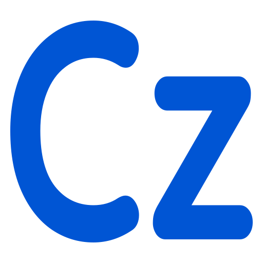
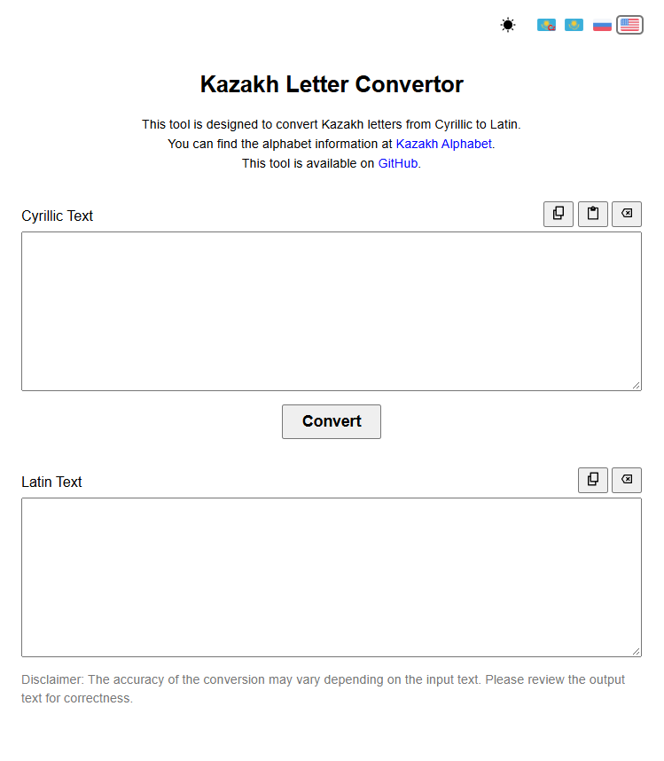
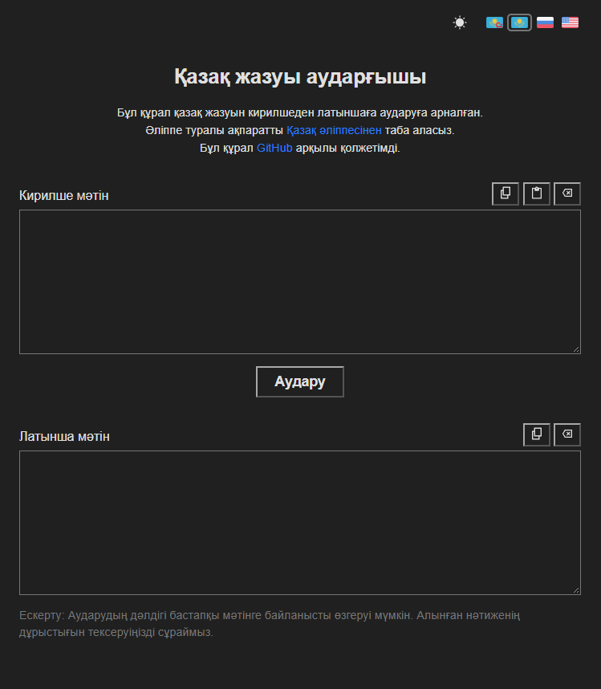

#  Kazakh Letter Convertor

This tool is designed to convert Kazakh letters from Cyrillic to Latin.

You can find the alphabet information at [Kazakh Alphabet](https://github.com/tolkensak).

 

## Usage

- For online access, you can use sites hosted on [Vercel](https://convertor-browser-pub.vercel.app) or [AWS](http://convertor-browser.s3-website-ap-southeast-2.amazonaws.com).

- For offline use, download [cazac-letter-convertor.html](./cazac-letter-convertor.html) and save it to your device.

 

## Implementations

- Multilingual

- Responsive Design

- Online and offline versions

- Dark mode support

Built with **HTML5, CSS3, SCSS, JavaScript, Webpack, AWS, Vercel** since 2023.

 

## Requirements

- **Internet Browser**

 

## License

This project is licensed under the MIT License — see the [LICENSE](LICENSE) file for details.

 

---

*"I just want people to have a normal alphabet."*